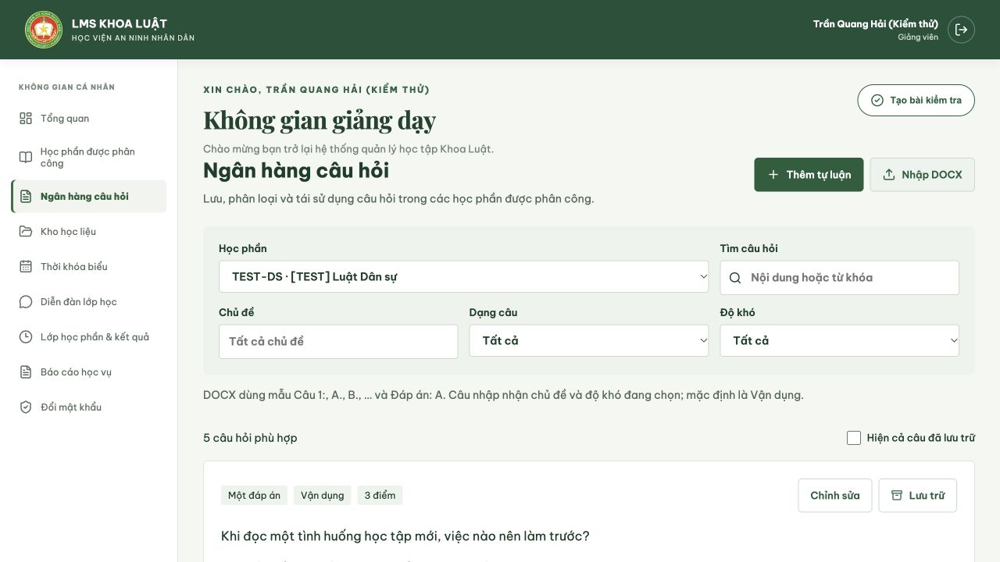
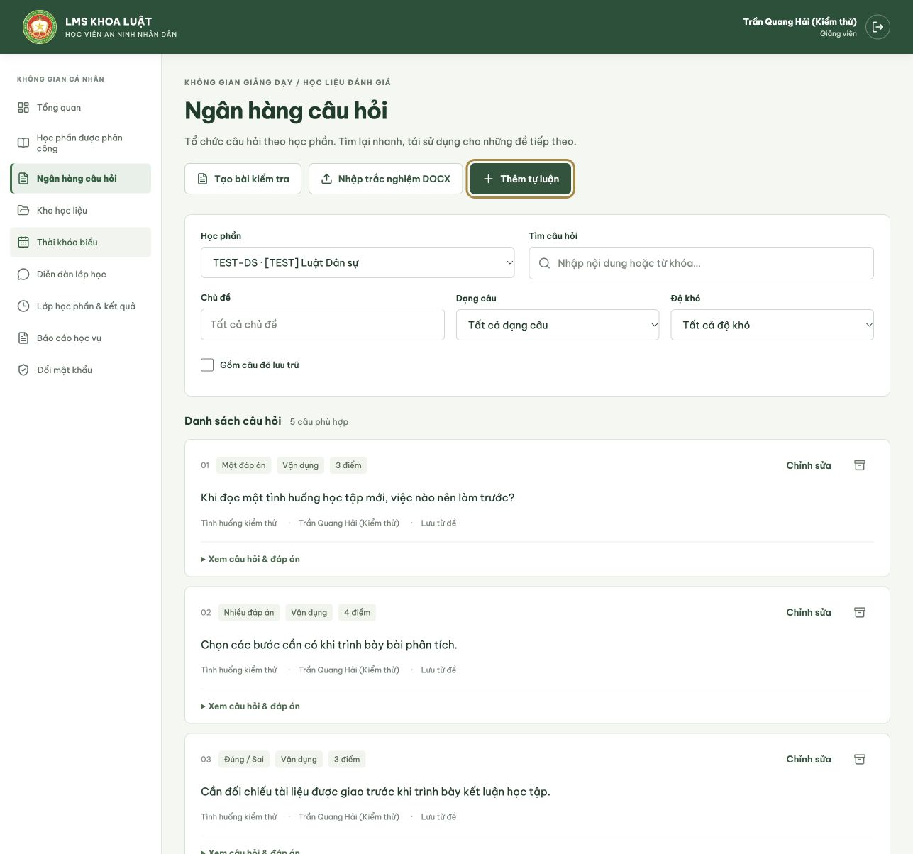
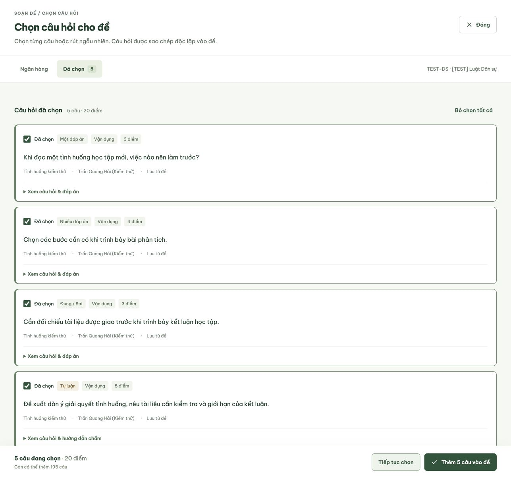
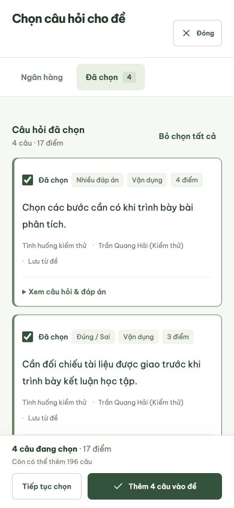

# Ngân hàng câu hỏi và trộn đề

## Workflow sử dụng

1. Giảng viên vào **Ngân hàng câu hỏi**, chọn học phần được phân công. Có thể thêm tự luận thủ công, nhập trắc nghiệm từ DOCX hoặc vào lớp học phần → bài kiểm tra → **Lưu vào ngân hàng**.
2. Phân loại bằng chủ đề và độ khó: Cơ bản, Vận dụng, Nâng cao. Điểm của câu trong ngân hàng là điểm mặc định khi sử dụng.
3. Khi tạo hoặc sửa đề nháp, chọn đúng lớp/học phần rồi bấm **Chọn từ ngân hàng**. Tìm theo từ khóa, lọc dạng câu/chủ đề/độ khó; tích từng câu, chọn cả trang hoặc nhập số lượng và bấm **Chọn thêm** trong vùng chọn ngẫu nhiên. Các câu đã có trong đề hoặc đã chọn được loại khỏi lần rút tiếp theo. Mục **Đã chọn** hiển thị đầy đủ danh sách và tổng điểm trước khi thêm vào đề; có thể bỏ từng câu tại đây.
4. Câu được sao chép vào danh sách soạn đề. Giảng viên có thể chỉnh nội dung/điểm của bản sao. Sửa hoặc lưu trữ câu gốc trong ngân hàng không cập nhật các đề đã lưu.
5. Bật **Trộn thứ tự câu hỏi** và/hoặc **Trộn phương án trắc nghiệm** theo từng lượt làm. Sau đó lưu nháp → gửi duyệt → Trưởng khoa công bố theo workflow hiện có.
6. Học viên bắt đầu bài: máy chủ tạo và lưu thứ tự riêng cho lượt đó. Lưu nháp, đóng/mở lại, nộp hoặc hết giờ đều dùng cùng thứ tự. Một lượt mới có thứ tự trộn độc lập.

Việc chọn ngẫu nhiên diễn ra khi giảng viên xây dựng đề: mỗi đề lưu một tập câu hỏi cụ thể. Trộn theo lượt chỉ đổi thứ tự câu và phương án trong tập câu đó. Các học viên vẫn làm cùng nội dung và thang điểm của đề đã được duyệt.

## Phân quyền và vòng đời

| Vai trò | Quyền |
| --- | --- |
| Giảng viên được phân công học phần | Xem và tái sử dụng ngân hàng chung của học phần; thêm câu của mình; sửa/lưu trữ/khôi phục câu do mình tạo. |
| Giảng viên không được phân công | Không đọc, nhập hoặc rút câu của học phần đó. |
| Trưởng khoa / Admin | Xem ngân hàng theo học phần để quản lý và kiểm tra; việc soạn đề và quản lý câu hỏi thuộc giảng viên. |
| Học viên | Không truy cập API ngân hàng và đáp án; chỉ nhận nội dung lượt làm theo ghi danh. |

- Tạo mới thủ công chỉ có tự luận. Trắc nghiệm mới nhập qua DOCX (`Câu 1:`, `A.`, `B.`, …, `Đáp án: A`) hoặc lấy từ đề hiện có. Nhập DOCX thiếu đáp án/phương án bị từ chối; không âm thầm nhập phần còn lại.
- Câu nhiều đáp án và đúng/sai có trong đề cũ được giữ đúng dạng khi lưu/tái sử dụng; không chuyển thành một đáp án hoặc tự luận.
- Nhập tối đa 200 câu/lần; tệp DOCX tối đa 10 MB với giới hạn giải nén. Câu trùng nội dung/dạng/phương án/đáp án của cùng tác giả trong cùng học phần được bỏ qua. Câu đã lưu trữ cũng được tính khi kiểm tra trùng; khôi phục nếu muốn dùng lại.
- Lưu trữ là thao tác có thể khôi phục. Bản nháp cập nhật dùng `revision`; dữ liệu cũ bị trả HTTP 409 thay vì ghi đè.
- Các phương án một/nhiều đáp án được trộn; thứ tự Đúng/Sai được giữ. Chấm điểm luôn đối chiếu ID câu hỏi và nội dung phương án, không dùng vị trí A/B/C/D sau khi trộn.
- Giao diện học viên không nhận đáp án đúng hoặc tiêu chí chấm. Người có quyền chấm nhìn bài theo thứ tự học viên đã làm. Hồ sơ xuất JSON có cấu hình trộn và thứ tự đã lưu.

## Dữ liệu và triển khai local

Migration: `backend/database/0014_question_bank_shuffle.sql` bổ sung `bank_questions`, hai cờ cấu hình trên `quizzes`, hai trường thứ tự trên `quiz_attempts`. Đề cũ mặc định tắt trộn; lượt cũ tiếp tục dùng thứ tự gốc.

```bash
dotnet build LMS.sln --no-restore
python3 scripts/database.py backup
python3 scripts/database.py upgrade 0014_question_bank_shuffle.sql
python3 scripts/seed_test_data.py
python3 scripts/run_local.py --restart
npm run build --prefix frontend
```

Bộ seed bổ sung câu hỏi từ các đề kiểm thử hiện có, không sửa đề/bài làm cũ. Với tài khoản `seed.giangvien3@lms.test`, chọn `TEST-DS` để thử tự luận và trắc nghiệm trong cùng ngân hàng. Tài khoản và mật khẩu thử được mô tả tại [Dữ liệu kiểm thử](DU_LIEU_KIEM_THU.md).

## Kiểm thử

```bash
dotnet test tests/LawLms.WorkflowTests/LawLms.WorkflowTests.csproj --no-build --no-restore
python3 scripts/test_question_bank.py
LMS_TEST_PORT=5168 python3 scripts/test_workflow.py
python3 scripts/seed_test_data.py --verify-only
```

`test_question_bank.py` dùng schema PostgreSQL và API cổng 5169 riêng (có thể đặt `LMS_BANK_TEST_PORT`), xóa schema sau khi chạy. Bao phủ phạm vi học phần, chủ sở hữu, dữ liệu cũ, nhập trùng/lỗi, chọn ngẫu nhiên, snapshot đề, sửa cấu hình, duyệt đề, bắt đầu đồng thời, lưu/tiếp tục/nộp, chấm tự động, hết giờ và xuất hồ sơ. Báo cáo: `docs/NGAN_HANG_CAU_HOI_KIEM_THU.json`.

## Xác nhận hoàn thiện ngày 19/10/2026

- Database local đã có migration `0014` và 27 câu hỏi kiểm thử; không cần nạp lại.
- Frontend và backend build thành công; 37 kiểm thử .NET và toàn bộ kiểm thử tích hợp ngân hàng/trộn đề đạt. Backend có cảnh báo `NU1900` do không truy cập được nguồn thông tin lỗ hổng NuGet.
- Kiểm tra trên trình duyệt với giảng viên kiểm thử: mở ngân hàng `TEST-DS`, chọn ngẫu nhiên 3 câu, đưa vào form soạn đề và sửa phương án của câu nhiều đáp án; đáp án đã chọn vẫn giữ đúng. Bản soạn kiểm tra được hủy sau khi xác nhận.
- Bộ chọn ngân hàng hiển thị ngoài form soạn đề, tránh thao tác Enter trong ô tìm kiếm gửi form đề. Đã sửa viền ô tìm kiếm và trạng thái tải dữ liệu.



## Cải tiến trải nghiệm sử dụng

- Trang ngân hàng có tiêu đề và thao tác riêng: tạo đề, nhập trắc nghiệm DOCX, thêm tự luận. Bỏ tiêu đề chào mừng lặp lại để dành chỗ cho danh sách.
- Tìm kiếm và bộ lọc có nhãn rõ ràng, hiển thị bộ lọc đang áp dụng và nút xóa. Trên điện thoại, **Bộ lọc chi tiết** có thể mở/thu gọn; học phần và tìm kiếm luôn sẵn dùng.
- Bộ chọn có hai mục **Ngân hàng / Đã chọn**, chọn cả trang, tổng số câu/tổng điểm và thanh thêm vào đề luôn hiện. Giới hạn 200 câu bao gồm các câu đã có trong đề. Chọn ngẫu nhiên áp dụng cả từ khóa tìm kiếm.
- Câu trắc nghiệm được hiển thị đáp án đúng bằng dấu kiểm và nhãn A/B/C/D; câu nhiều đáp án không còn hiển thị chuỗi JSON.
- Nhập DOCX có hộp chọn/kéo thả tệp, kiểm tra định dạng/dung lượng và chủ đề/độ khó riêng; bộ lọc tìm kiếm không quyết định metadata khi nhập.
- Form câu hỏi hiển thị trường bắt buộc, số ký tự và trạng thái chưa lưu. Hộp cảnh báo trong LMS bảo vệ nội dung hoặc danh sách đang chọn khi đóng. Nút tiếp tục được ưu tiên focus; Escape, khóa focus trong hộp thoại và trả focus khi đóng dùng cơ chế dialog của trình duyệt.
- Có phản hồi thành công/lỗi riêng, nút tải lại khi lỗi kết nối và hoàn tác thao tác lưu trữ vừa thực hiện. Nút Hủy form tạo đề hiển thị cả trên mobile.

Đã kiểm tra trực tiếp tại **1287 × 1204** và **390 × 844**: tìm kiếm rỗng/xóa lọc; chọn DOCX trước khi nhập; giữ nội dung khi hủy đóng form; chọn cả 5 câu (20 điểm), bỏ 1 câu còn 4 câu (17 điểm), giữ lựa chọn khi hủy đóng và thêm vào form đề; mở/thu gọn bộ lọc mobile; form tự luận mobile và nút Hủy tạo đề. Các bản nhập thử được đóng, không lưu thành câu hỏi/đề mới trong database local. Nút thử lại cũng đã khôi phục dữ liệu sau một lần API local khởi động lại.

Kiểm tra tự động: frontend/backend build thành công, 37 kiểm thử .NET đạt; kiểm thử tích hợp ngân hàng/trộn đề đạt, gồm trường hợp rút câu theo từ khóa và từ khóa không có kết quả. Cảnh báo NuGet `NU1900` về nguồn dữ liệu lỗ hổng vẫn như trên.




