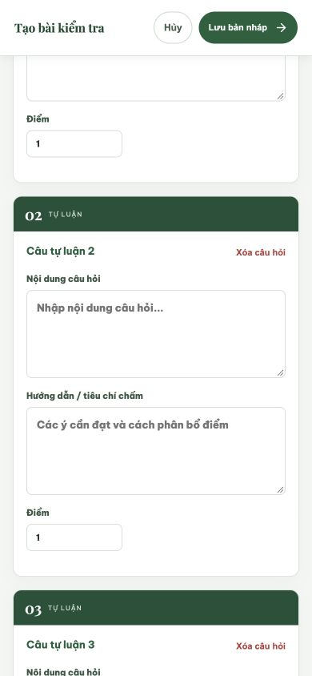
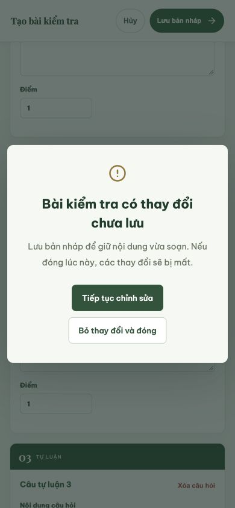
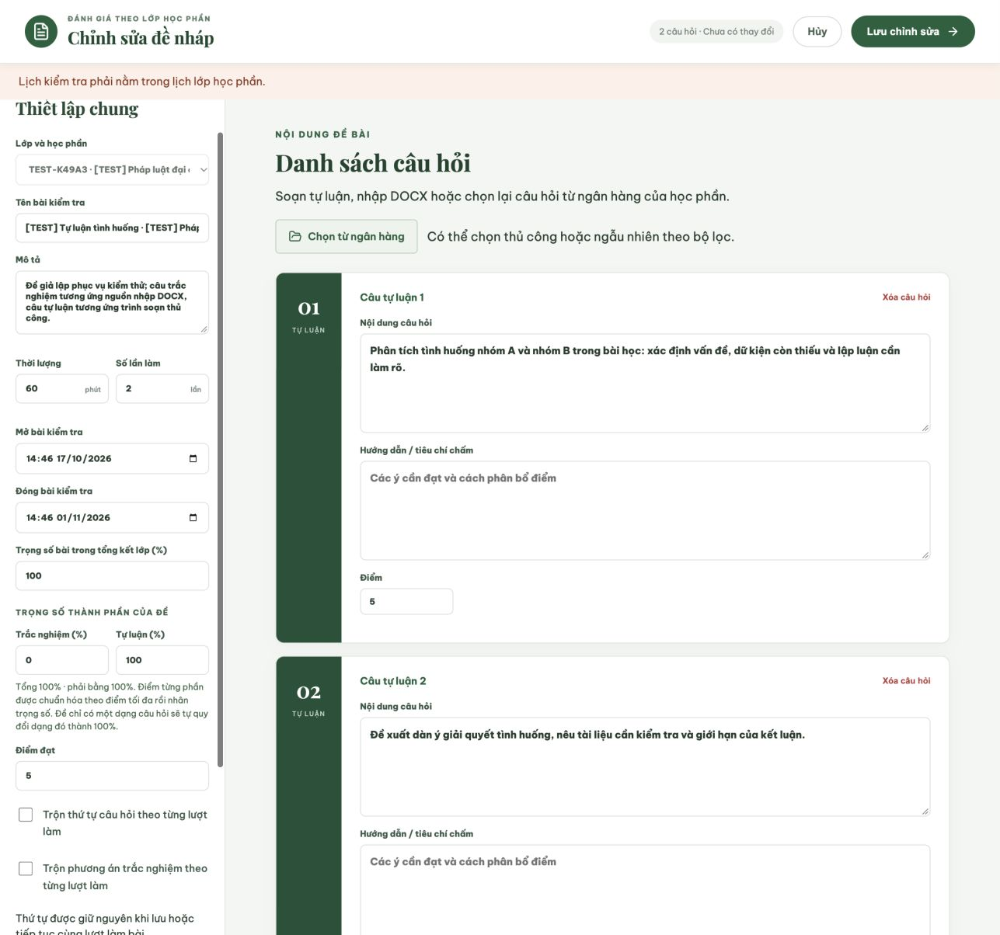

# Kiểm tra trải nghiệm soạn đề — 19/10/2026

Tiếp tục phần tối ưu ngân hàng câu hỏi và soạn đề. Đợt này bổ sung bảo vệ thay đổi chưa lưu cho form đề, xác nhận đổi lớp trong LMS, quản lý focus/cuộn cho các dialog lồng nhau và sửa nút tạo đề mới sau khi sửa một bản nháp.

## Đã kiểm tra trực tiếp

- **390 × 844:** cuộn tới danh sách câu hỏi, thêm câu tự luận; thanh Hủy/Lưu vẫn ở đầu màn hình. Đã sửa vùng nội dung bị cắt và việc hộp soạn đề tự cuộn làm mất thanh hành động.
- Hủy một form có thay đổi mở cảnh báo; nút **Tiếp tục chỉnh sửa** được focus trước và giữ nguyên nội dung. Bỏ thay đổi đóng các hộp thoại và trả `body.style.overflow` về giá trị ban đầu.
- Mở ngân hàng bên trong form đề, chọn cả 5 câu của `TEST-DS`: **20 điểm**; đưa vào đề nhận đủ 5 câu.
- Đổi lớp khi đang có câu hỏi mở cảnh báo. Escape giữ nguyên lớp Dân sự và 5 câu. Chấp nhận đổi sang lớp Hành chính xóa danh sách câu cũ, tạo một câu tự luận trống và giữ tên bài kiểm tra.
- **1287 × 1204:** bản nháp có sẵn hiển thị hai vùng thiết lập/soạn câu; chiều rộng hộp thoại 1287 px, vùng soạn không tràn ngang.
- Đóng bản nháp vừa tải, chưa sửa: không hỏi bỏ thay đổi. Sau đó bấm nút **Tạo bài kiểm tra** đầu trang: mở form mới, tên trống và chọn lớp được bật, không mở lại bản nháp cũ.
- Lỗi máy chủ khi lưu hiển thị ngay dưới thanh hành động bằng vùng `role="alert"`. API đã từ chối lần lưu kiểm tra vì lớp chưa thiết lập lịch; bản nháp trong database được giữ nguyên.

Các bản soạn thử được hủy. Không công bố đề hoặc thay đổi câu hỏi trong ngân hàng.

## Kiểm tra mã nguồn

`npm run build --prefix frontend` và `git diff --check` đạt. Không thay đổi backend trong đợt này; kết quả kiểm thử tích hợp trước đó được ghi riêng tại `NGAN_HANG_CAU_HOI.md`.

