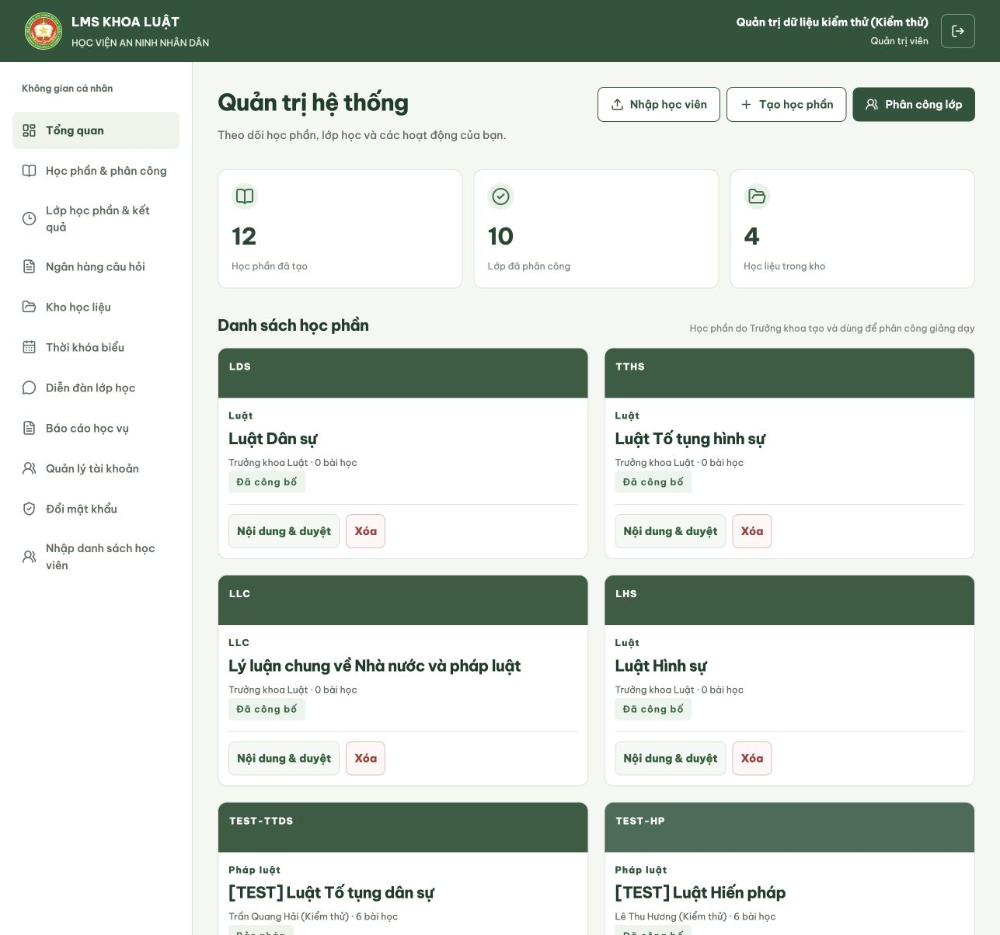
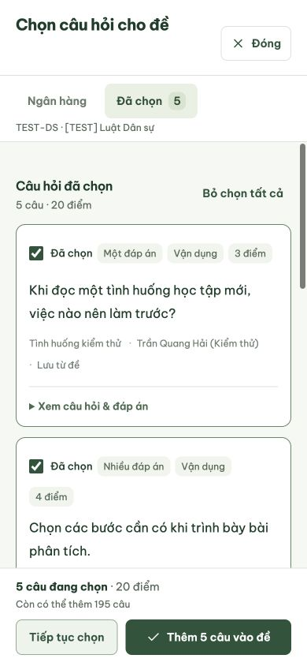

# Nghiệm thu UI thống nhất — 20/10/2026

Áp dụng [quy chuẩn đã duyệt](QUY_CHUAN_UI.md) cho giao diện LMS. Nghiệm thu bằng trình duyệt với API và tài khoản seed local; không dùng dữ liệu giả thay thế khi API thiếu dữ liệu.

## Kết quả

- Frontend build đạt: `npm run build --prefix frontend`.
- `git diff --check` đạt.
- Kiểm tra CSS: 18 stylesheet phân tích hợp lệ, 36 token `--ui-*`, không có token UI được tham chiếu nhưng chưa khai báo.
- Lint phần công khai với `design-taste-frontend`: 0 FAIL, 0 WARN trên `landing.css`, `landing-information.css`, `LandingInformation.tsx`.
- Đã ghi **43 bố cục/trạng thái theo vai trò và viewport**. Cả ba kích thước **1287×1204**, **768×1024**, **390×844** đều có bằng chứng. Những trường hợp ghi nhận không tràn ngang toàn trang; đồng thời đã xem ảnh để phát hiện lỗi mà phép đo chiều rộng không thể hiện.
- Báo cáo máy đọc: [UI_KIEM_THU_KET_QUA.json](UI_KIEM_THU_KET_QUA.json). Ảnh nằm trong [ui-kiem-thu](ui-kiem-thu/).

## Phạm vi đã kiểm tra

| Nhóm | Màn hình/trạng thái đại diện |
| --- | --- |
| Admin | Tổng quan, tài khoản, lớp học phần, ngân hàng, báo cáo, lịch, diễn đàn, kho học liệu và nhập học viên. Bảng và bộ lọc được kiểm tra ở desktop/tablet/mobile. |
| Trưởng khoa | Danh sách học phần, form phân công, nội dung/xử lý học phần, báo cáo. Có ảnh desktop và mobile. |
| Giảng viên | Ngân hàng `TEST-DS`, form tự luận, nhập DOCX, bộ chọn câu, soạn đề và chấm bài. Kiểm tra ngân hàng desktop và các form/bộ chọn trên mobile. |
| Học viên | Lớp học phần, danh sách học phần, đọc bài, diễn đàn và báo cáo học tập. Có ảnh desktop/mobile; menu không có ngân hàng, tài khoản hoặc báo cáo quản trị. |
| Công khai | Trang giới thiệu ở ba viewport, đăng nhập bằng tài khoản seed, lỗi đăng nhập và mở nội dung hướng dẫn tài khoản trên mobile. Giữ nội dung, ảnh và logo hiện có của dự án. |

## Thao tác đã xác nhận

1. Menu mobile mở/đóng, chuyển trang và cập nhật mục hiện tại. Trang kho học liệu không lặp lại thống kê/danh sách học phần phía trên.
2. Danh mục **Bài giảng (1)** trong kho học liệu mobile lọc đúng một tài liệu.
3. Chọn cả 5 câu của `TEST-DS`: bộ xem lại hiển thị **5 câu / 20 điểm**, thêm vào form đề nhận đủ 5 câu.
4. Form xếp lịch có nội dung mới: Escape mở cảnh báo; **Tiếp tục chỉnh sửa** giữ nguyên tên buổi đã nhập. Bỏ thay đổi đóng các dialog và trả cuộn trang về trạng thái ban đầu.
5. Chỉnh nhận xét ở bài tự luận đang chờ chấm: Đóng mở xác nhận; Hủy quay lại bài chấm. Chỉ bỏ bản chỉnh sửa trên giao diện, không lưu điểm/nhận xét vào máy chủ.
6. Hộp nhập học viên dùng toàn màn hình; Tab giữ focus trong dialog, Escape đóng và khôi phục cuộn trang. Các form dài và bộ chọn câu có vùng cuộn riêng.
7. Đăng nhập bằng mật khẩu thử sai một lần: nhận thông báo đỏ `role="alert"`. Đây là lỗi chủ động kiểm tra, không phải một ca nghiệm thu thất bại.
8. Báo cáo và không gian đọc bài của học viên dùng Be Vietnam Pro; đã loại bỏ font Georgia riêng trong báo cáo học viên.

## Lỗi phát hiện qua ảnh và đã sửa

- Lịch có nhiều sự kiện trong cùng ngày: sự kiện thứ hai từng rơi xuống cột ngày hẹp ở tablet; nay các sự kiện cùng nằm trong cột nội dung.
- Header mobile: tên tài khoản dài từng làm nội dung vượt chiều cao header; nay tên rút gọn bằng dấu ba chấm và vai trò vẫn hiển thị.
- Danh mục kho học liệu từng bị ẩn trên điện thoại; nay có dropdown thay thế cây thư mục desktop.
- Tiêu đề kho học liệu/tài khoản/báo cáo và sidebar cũ từng dùng quy tắc riêng; nay dùng thành phần chung, bỏ các rule điều hướng lỗi thời.
- Đã chuẩn hóa cả font viết trong thuộc tính `font` dạng rút gọn; kiểm tra `font-family` đơn lẻ trước đó chưa phát hiện Georgia ở báo cáo học viên.

## Giới hạn kiểm tra

Đây là kiểm tra UI và các tương tác đại diện, không thay cho kiểm thử tích hợp toàn bộ nghiệp vụ. Đợt này không import XLSX/DOCX thật, không tạo/xóa/công bố học phần, không lưu điểm, không bắt đầu/nộp lượt làm bài mới. Thời gian thi phía máy chủ, tính điểm và các chuyển trạng thái duyệt chưa chạy lại kiểm thử tích hợp trong đợt đồng nhất UI này.

Phần công khai chỉ điều chỉnh nhận diện/điều khiển chung. Không vẽ hướng thiết kế mới, không thêm ảnh hay thay nội dung giới thiệu. Dùng CUA để xem và thao tác trình duyệt ở ba viewport; không chạy bộ điều khiển trình duyệt CDP riêng của `inspect.mjs`, nên không tuyên bố đã qua toàn bộ cổng đo tự động của skill.

