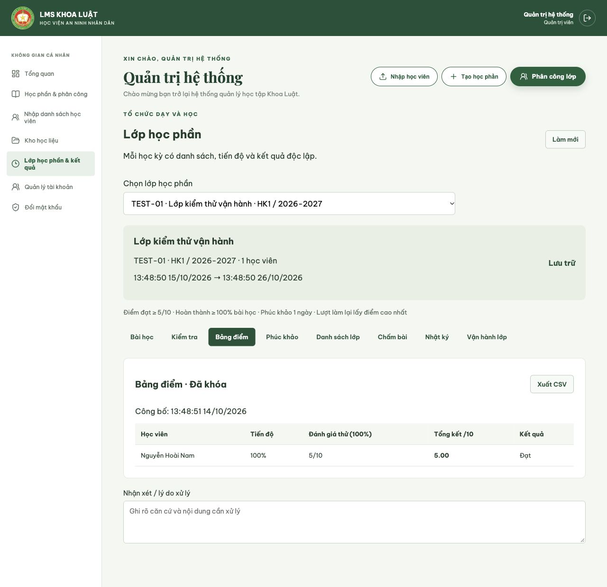

# Bàn giao vận hành LMS

Ngày cập nhật: 16/10/2026.

**Kết quả nghiệm thu:** 21 unit test, 25 nhóm kiểm thử tích hợp API/PostgreSQL đạt; backend và frontend build thành công. Đã kiểm tra thao tác tạo/sửa nội dung và bảng điểm bằng trình duyệt. Chi tiết tại [Báo cáo nghiệm thu](BAO_CAO_NGHIEM_THU.json). Áp dụng cho bản nâng cấp workflow trong repository này.

## 1. Phạm vi đã triển khai

| Quy trình | Hành vi trên hệ thống |
| --- | --- |
| WF-01: dữ liệu và tài khoản | Admin tạo tài khoản, xem trước XLSX, nhập dòng hợp lệ, tải báo cáo lỗi và mật khẩu tạm riêng. Bắt buộc đổi mật khẩu lần đầu; khóa/mở khóa, cấp lại mật khẩu và thu hồi phiên cũ. |
| WF-02: lớp học phần | Một lớp hành chính có nhiều học phần/học kỳ. Định danh riêng theo mã lớp + học phần + năm học + học kỳ. Đối soát danh sách có lý do; rút/khôi phục ghi danh giữ lại tiến độ và bài nộp cũ. |
| WF-03: chuẩn bị nội dung | Bản nháp → chờ duyệt → công bố; trả lại có lý do; khóa nội dung đã gửi duyệt. Sao chép học phần thành phiên bản có mã mới để chỉnh sửa mà không đổi nội dung lớp cũ. |
| WF-04: học và hỗ trợ | Xem lớp được ghi danh, bài học và tiến độ theo lớp học phần; xác nhận đã học xong từng bài. Thông báo nội bộ nhắc hạn và thiếu hoạt động học tập. |
| WF-05: đánh giá | Tạo tự luận thủ công hoặc nhập trắc nghiệm DOCX; thiết lập lịch, trọng số, thời lượng và số lượt. Xem đề/tiêu chí trước duyệt; đề bị trả lại có thể sửa hoặc xóa khi còn nháp và chưa có bài làm. Máy chủ tạo lượt, lưu nháp, giữ hạn giờ và tự nộp. Quyết định gia hạn/thêm lượt theo từng học viên có nhật ký. |
| WF-06: điểm | Tự chấm khách quan, chấm tự luận và nhận xét, tổng hợp trọng số hệ 10. Giảng viên chính gửi bảng điểm; Trưởng khoa/Admin duyệt rồi công bố. Học viên chỉ thấy điểm và phản hồi của mình sau công bố. |
| WF-07: kết thúc | Học viên gửi phúc khảo, phân công người khác chấm lại, gửi đề xuất và duyệt điều chỉnh có lưu điểm cũ. Chặn kết thúc trước hạn phúc khảo hoặc còn yêu cầu tồn. Đóng/lưu trữ chỉ đọc; xuất CSV bảng điểm và JSON hồ sơ đầy đủ. |
| WF-08: thời khóa biểu | Trưởng khoa/Admin xếp lịch học/thi, phòng và địa điểm; chặn trùng phòng/giảng viên; đổi/hủy có lịch sử và thông báo; tải `.ics`; nhắc lịch trong LMS trước 24 giờ. |
| WF-09: diễn đàn lớp học | Trao đổi theo lớp học phần; học viên/giảng viên được phân công đăng câu hỏi và phản hồi; người theo dõi nhận thông báo trong LMS; giảng viên phụ trách ghim/bỏ ghim câu trả lời. Trưởng khoa/Admin chỉ xem; chỉ Trưởng khoa/Admin đọc được diễn đàn của mọi lớp. |
| WF-10: báo cáo học tập cá nhân | Học viên xem tiến độ bài học, chuyên cần theo các buổi đã kết thúc và điểm thành phần sau khi bảng điểm được duyệt/công bố. Giảng viên phụ trách ghi có mặt/vắng/có phép; mỗi lần cập nhật được lưu nhật ký. Buổi chưa điểm danh hiển thị riêng, không tự tính thành vắng. |

Các chức năng này có API và giao diện. Tích hợp email/SMS, SSO/SIS và chứng chỉ chưa được cấu hình; thông báo hiện nằm trong hệ thống. Những phần tích hợp này không phải điều kiện chạy workflow lớp học phần hiện tại.

Lịch `.ics` là tệp tải xuống theo quyền đăng nhập, không tự làm mới khi lịch đổi. Người dùng cần tải lại để cập nhật; email/SMS và lịch đăng ký tự đồng bộ chưa được cấu hình.

## 2. Database đã nâng cấp

Các script đã được áp dụng vào PostgreSQL local theo cấu hình riêng của dự án:

- `0006_course_review_workflow.sql`: trạng thái, phiên bản và lịch sử duyệt học phần.
- `0007_operational_workflow.sql`: lớp học phần, ghi danh riêng, tiến độ bài, lượt làm có thời hạn, nhật ký và phúc khảo.
- `0008_appeal_proposal.sql`: lưu đề xuất điểm phúc khảo trước khi duyệt.
- `0009_notifications_allowances.sql`: thông báo chống trùng và gia hạn cá nhân.
- `0010_quiz_component_weights.sql`: trọng số trắc nghiệm/tự luận; dữ liệu đề cũ được gán trọng số theo điểm tối đa để giữ tỷ lệ tính điểm cũ.
- `0011_schedule.sql`: sự kiện thời khóa biểu theo lớp học phần và lịch sử thay đổi/hủy.
- `0012_class_forum.sql`: chủ đề, phản hồi, theo dõi và câu trả lời được ghim trong diễn đàn lớp.
- `0013_attendance.sql`: điểm danh theo từng buổi học, người ghi nhận và thời điểm cập nhật.

Đối soát migration, dữ liệu và bản sao lưu: [Báo cáo nâng cấp database](BAO_CAO_NANG_CAP_DB.json).

Bảng `lms_schema_versions` ghi nhận các script đã áp dụng. Mỗi script chạy trong transaction. Dữ liệu LMS cũ giữ nguyên; các bảng tên viết hoa có sẵn không bị đổi tên hoặc xóa. Học phần cũ vẫn được công bố như trước và không được gán lịch sử duyệt giả.

Bản sao lưu sau nâng cấp: `.backups/lms-backup-20261016-140031.dump`, đi kèm `.backups/lms-backup-20261016-140031.files.tar.gz` cho kho tệp.

Bản sao lưu trước nâng cấp: `.backups/lms-backup-20261016-085634.dump` (không đưa vào Git). Đã phục hồi thử vào database riêng và đối soát thành công: 6 tài khoản, 4 học phần, 1 phân công lớp, 0 lượt làm bài tại thời điểm sao lưu.

Danh sách ghi danh cũ được chụp từ mã lớp hiện có. Những lớp cũ chưa có lịch và chính sách vẫn ở trạng thái **Bản nháp**. Trưởng khoa cần xác nhận học kỳ, lịch bắt đầu/kết thúc, điểm đạt, tiến độ yêu cầu và thời hạn phúc khảo trước khi mở lớp; hệ thống không tự suy diễn lịch đào tạo.

## 3. Khởi chạy local

```bash
# Chạy tại thư mục repository, sau khi build backend.
dotnet build LMS.sln
python3 scripts/run_local.py

# Terminal khác:
cd frontend
npm run dev
```

API: `http://localhost:5155`; frontend: `http://localhost:5173`; kiểm tra database: `GET /health`.

`scripts/run_local.py --restart` chỉ dừng tiến trình nghe ở cổng 5155 khi thư mục làm việc khớp backend dự án; sau đó chạy bản đã build. Script giữ cấu hình riêng trong `backend/appsettings.Local.json`, tạo khóa JWT đủ dài nếu chưa có và tắt seed demo cho database vận hành. File cấu hình riêng và bản sao lưu được loại khỏi Git.

Sau nâng cấp, đăng nhập lại. Tài khoản cũ được yêu cầu đổi mật khẩu lần đầu. Admin có thể cấp lại mật khẩu tạm trong **Quản lý tài khoản**. Khi đổi hoặc cấp lại mật khẩu, token cũ hết hiệu lực.

Vite có proxy `/api` đến API local. Có thể đặt `VITE_API_URL=/api`; môi trường triển khai cần reverse proxy tương ứng hoặc cấu hình `VITE_API_URL` thành địa chỉ API và CORS allowlist đúng origin. `LMS_API_PROXY` chỉ phục vụ chọn API cho dev server/kiểm thử.

## 4. Thực hiện một lớp từ đầu đến cuối

1. **Admin → Nhập danh sách học viên:** tải mẫu, chọn tệp, kiểm tra xem trước, đối soát rồi xác nhận nhập. Tải mật khẩu tạm riêng và bàn giao riêng cho chủ tài khoản. Dòng lỗi có báo cáo tải xuống.
2. **Trưởng khoa → Học phần & phân công:** tạo học phần, mở **Nội dung & duyệt**, thêm bài, gửi duyệt. Trả lại hoặc duyệt/công bố; chỉnh sửa bài học khi còn nháp. Có thể phân công tổ giảng viên từ khi nội dung còn nháp.
3. **Trưởng khoa → Phân công lớp:** chọn học phần, mã lớp hành chính, năm học, học kỳ và ba giảng viên khác nhau (1 chính + 2 phụ). Mỗi kỳ tạo một lớp học phần riêng; không sửa lớp cũ thành kỳ mới.
4. **Trưởng khoa → Lớp học phần & kết quả:** chọn đúng lớp/kỳ. Trong **Vận hành lớp**, cấu hình lịch và chính sách. Trong **Danh sách lớp**, nhập lý do rồi **Đối soát theo lớp**. Đối soát lại mỗi khi nhập học viên muộn/chuyển lớp.
5. **Trưởng khoa:** xác nhận sẵn sàng rồi mở lớp khi đã tới lịch bắt đầu. Thiếu bài, danh sách hoặc học phần chưa được duyệt thì chưa mở được.
6. **Học viên → Bài học:** học nội dung và xác nhận đã học xong. Tiến độ này phản ánh xác nhận hoàn thành hoạt động, không tự thay thế kết quả đánh giá năng lực.
7. **Tổ giảng viên → Kiểm tra:** tạo đề, nhập lịch trong lịch lớp, điểm đạt và trọng số. Tự luận nhập thủ công; trắc nghiệm vẫn nhập DOCX. Cấu hình trọng số trắc nghiệm và tự luận (tổng 100%), cùng trọng số bài kiểm tra trong tổng kết. Gửi duyệt; Trưởng khoa xem đề/tiêu chí chấm rồi công bố hoặc trả lại.
8. **Học viên → Kiểm tra:** bắt đầu/tiếp tục cùng lượt đang làm. Lưu nháp tự động mỗi 15 giây hoặc bấm lưu ngay. Lần máy chủ xác nhận lưu gần nhất được hiển thị. Khi nộp, giữ số biên nhận; điểm chưa được trả về ở bước này.
9. **Tổ giảng viên → Chấm bài:** chấm đủ từng câu theo tiêu chí, điểm không vượt điểm tối đa; nhập phản hồi. Các giảng viên chỉ chấm lớp được phân công.
10. **Tổ giảng viên:** đóng toàn bộ bài kiểm tra, chờ các lượt đang làm tự nộp hoặc học viên nộp xong. Trưởng khoa chuyển lớp sang giai đoạn chấm điểm.
11. **Giảng viên chính:** đối soát bảng điểm, tổng trọng số phải đúng 100%, mọi bài đã nộp phải chấm xong; gửi duyệt. Trưởng khoa/Admin duyệt rồi công bố. Có thể trả lại trước công bố để sửa.
12. **Học viên → Bảng điểm:** xem kết quả và bài/nhận xét sau công bố; gửi phúc khảo trong thời hạn với lý do cụ thể.
13. **Trưởng khoa → Phúc khảo:** phân công giảng viên chưa chấm bài đó. Người được giao xem bài, chấm lại và gửi đề xuất; điểm chính thức chưa đổi cho đến khi người duyệt khác phê duyệt. Điều chỉnh được lưu trong nhật ký và mở lại thời hạn phúc khảo kể từ lần công bố điều chỉnh.
14. **Trưởng khoa:** sau thời hạn và hết yêu cầu tồn, kết thúc lớp rồi lưu trữ. Xuất hồ sơ JSON và bảng điểm CSV. Lớp đã hoàn thành/lưu trữ khóa sửa dữ liệu.

## 5. Quy tắc và xử lý ngoại lệ

- Hạn lượt làm mặc định là thời điểm sớm hơn giữa bắt đầu + thời lượng và hạn đóng đề. Thời gian được chuẩn hóa UTC ở API; giao diện hiển thị theo múi giờ trình duyệt.
- Nộp lại cùng lượt trả về cùng biên nhận. Hai yêu cầu bắt đầu đồng thời chỉ tạo một lượt. Số lượt được kiểm tra trong transaction và có khóa theo lớp/học viên.
- Lưu nháp dùng phiên bản. Khi hai cửa sổ sửa cùng lượt, bản cũ bị từ chối thay vì ghi đè. Đóng/mở lại lượt để nhận trạng thái máy chủ; nội dung chưa được máy chủ xác nhận vẫn chỉ ở cửa sổ hiện tại.
- Tác vụ máy chủ quét lượt hết hạn mỗi 10 giây. Khi API bị ngừng, lượt đến hạn được xử lý sau khi API chạy lại; nội dung gửi sau hạn không thay thế bản nháp trước hạn.
- **Gia hạn/thêm lượt:** Trưởng khoa/Admin chọn học viên, tổng số lượt bổ sung và hạn riêng trong lịch lớp, bắt buộc nhập lý do. Hạn riêng cập nhật lượt đang làm nếu có. Thêm lượt không tự mở lại bài đã đóng; đóng đề dừng cả lượt có gia hạn.
- Trọng số thành phần trắc nghiệm/tự luận của từng đề phải cộng đúng 100%. Điểm mỗi phần được chuẩn hóa theo điểm tối đa phần đó, nhân trọng số, rồi quy về thang điểm tối đa của đề; nếu đề chỉ có một dạng câu hỏi, dạng đó được chuẩn hóa thành 100%. Trọng số của đề trong tổng kết lớp là thiết lập riêng. Đề đã có trước migration giữ tỷ lệ cũ theo điểm tối đa câu hỏi.
- Kết quả làm lại chọn lượt có điểm cao nhất; tổng kết quy đổi từng bài về hệ 10, nhân trọng số và làm tròn 2 chữ số ở tổng cuối. Bài không nộp tính 0; bài đã nộp chưa chấm chặn gửi duyệt bảng điểm.
- Sau khi bảng điểm được gửi duyệt, chấm và đổi danh sách bị khóa; trả lại trước công bố nếu cần sửa. Sau công bố, điều chỉnh qua phúc khảo có đề xuất và duyệt, không sửa điểm trực tiếp.
- Thông báo nội bộ được kiểm tra mỗi phút: đề cần duyệt, bảng điểm cần duyệt, bài còn dưới 24 giờ với học viên chưa nộp, và chưa ghi nhận hoàn thành bài/lượt kiểm tra trong 7 ngày. Thông báo có khóa chống trùng và trạng thái đã đọc theo người dùng.
- Kho học liệu hiện là kho dùng chung cho người dùng đã đăng nhập, được ghi rõ trên màn hình. Nội dung lớp và đề kiểm tra nằm ở các luồng kiểm soát ghi danh riêng.

## 6. Kiểm tra và phục hồi

```bash
dotnet test tests/LawLms.WorkflowTests/LawLms.WorkflowTests.csproj
npm run build --prefix frontend

# Thực hiện migration theo phiên bản; tự bỏ qua script đã được ghi nhận.
python3 scripts/database.py upgrade 0006_course_review_workflow.sql 0007_operational_workflow.sql 0008_appeal_proposal.sql 0009_notifications_allowances.sql 0010_quiz_component_weights.sql 0011_schedule.sql 0012_class_forum.sql 0013_attendance.sql

# Sao lưu PostgreSQL và kho tệp vào .backups/.
python3 scripts/database.py backup

# Phục hồi thử sang một database có tên mới, không ghi đè database hiện có.
python3 scripts/verify_restore.py .backups/TEN_BAN_SAO_LUU.dump

# Nghiệm thu API thật trên schema kiểm thử riêng.
LMS_TEST_PORT=5168 python3 scripts/test_workflow.py
```

Script tích hợp tạo schema `lms_test_*`, seed tài khoản thử trong schema đó, mở API riêng và dừng API sau khi chạy. Không dùng các tài khoản thử cho dữ liệu vận hành. Schema được giữ làm bằng chứng; muốn xem qua giao diện có thể chạy `python3 scripts/run_local.py --test`, rồi dev server với `VITE_API_URL=/api LMS_API_PROXY=http://localhost:5166 npm run dev -- --port 5174`.

Backup trước nâng cấp đã được phục hồi và đối soát số lượng. Script backup mới còn tạo tệp `.files.tar.gz` đi kèm kho học liệu. Khi khôi phục thực tế cần đối soát database và kho tệp cùng mốc, thử ở môi trường riêng trước; không ghi đè dữ liệu bài nộp mới bằng backup cũ.

## 7. Điều kiện mở rộng vận hành

Bản này chạy workflow lớp học phần trên local và có kiểm thử tích hợp tự động. Đưa lên server cần cấu hình HTTPS, lưu trữ bền vững, secret manager, giám sát, lịch backup và kế hoạch khôi phục của đơn vị; không coi bản chạy local là kết quả đã kiểm thử tải hay xác nhận RPO/RTO production.

Trước pilot, Trưởng khoa xác nhận lịch thực tế, chính sách điểm, hạn phúc khảo và tổ giảng viên; Admin đối soát tài khoản, sĩ số và kết quả chạy thử với người dùng thật. Các mục này cần dữ liệu và quyết định của đơn vị, không được tự sinh để thay cho phê duyệt học vụ.

## 8. Ảnh nghiệm thu

Ảnh dưới đây dùng dữ liệu kiểm thử trong schema riêng, không phải bảng điểm vận hành thật.



## Báo cáo học vụ và học viên cần hỗ trợ

Menu **Báo cáo học vụ** dành cho Admin, Trưởng khoa và giảng viên. Giảng viên chỉ xem các lớp được phân công chính hoặc trợ giảng; học viên không được gọi cả API xem lẫn xuất CSV.

- Lọc năm học, học kỳ, giai đoạn; bấm mã lớp để thu hẹp vào một lớp. Danh sách hỗ trợ có phân trang, lọc nhóm và ngưỡng tùy chỉnh.
- Mốc tiến độ = tỷ lệ thời gian đã qua × tiến độ bắt buộc; khi chấm điểm, mốc bằng tiến độ bắt buộc. Thiếu lịch hợp lệ không suy đoán mốc.
- Chậm tiến độ khi tiến độ thực tế cộng ngưỡng chậm vẫn nhỏ hơn mốc. Thiếu hoạt động mặc định 7 ngày, tính từ thời điểm muộn hơn giữa bắt đầu lớp và ghi danh. Hoạt động chỉ gồm hoàn thành bài học, bắt đầu/nộp bài; không dùng đăng nhập hay tác vụ tự động.
- Chưa nộp xét hạn riêng được duyệt; khi bài đã đóng thì dùng hạn đóng chung. Các lượt nộp đang chờ chấm được thống kê riêng.
- Tỷ lệ đạt chỉ tính lớp đã công bố/khóa điểm. Ghi danh đã rút không tính vào báo cáo; một người học nhiều lớp tạo nhiều lượt ghi danh.
- CSV lớp xuất các lớp đã lọc; CSV hỗ trợ xuất toàn bộ danh sách phù hợp ở tất cả trang. Có BOM UTF-8, dấu nháy bảo toàn cột và vô hiệu hóa công thức bảng tính.
- Báo cáo đọc dữ liệu trong một snapshot PostgreSQL nhất quán, không sửa dữ liệu nghiệp vụ. Các chỉ báo hỗ trợ không tự thay đổi kết quả học tập.

Kiểm chứng bổ sung: 30 unit tests, 22 nhóm tích hợp PostgreSQL; kết quả lưu tại `BAO_CAO_HOC_VU_NGHIEM_THU.json`. Dữ liệu kiểm thử nằm trong schema riêng.

Kiểm chứng thời khóa biểu (17/10/2026): backend/frontend build đạt; 23 nhóm workflow tích hợp qua PostgreSQL/API đạt, gồm phạm vi xem theo vai trò, xung đột phòng và giảng viên, thay đổi/hủy có lịch sử, thông báo và xuất `.ics`. Migration `0011_schedule.sql` đã áp dụng vào PostgreSQL local sau khi tạo backup `.backups/lms-backup-20261017-101918.dump` cùng archive kho tệp.

Kiểm chứng diễn đàn (17/10/2026): backend/frontend build đạt; 24 nhóm workflow tích hợp qua PostgreSQL/API đạt. Kiểm tra quyền theo lớp, từ chối người ngoài lớp, theo dõi chủ đề, thông báo phản hồi, chỉ giảng viên được phân công ghim đáp án và cập nhật thông báo trên giao diện. Migration `0012_class_forum.sql` đã áp dụng vào PostgreSQL local sau backup `.backups/lms-backup-20261017-214524.dump` và archive kho tệp cùng mốc. Thông báo diễn đàn trong giao diện được làm mới mỗi 30 giây hoặc khi quay lại tab; chưa cấu hình email/SMS hay thông báo đẩy.

Kiểm chứng báo cáo học tập cá nhân: Trưởng khoa/Admin không thể gọi API học viên; báo cáo chỉ truy vấn danh sách ghi danh của tài khoản hiện tại. Chuyên cần tính trên các buổi học đã kết thúc và đã được điểm danh; buổi chưa ghi nhận được báo riêng, không mặc định là vắng. Điểm thành phần chỉ xuất sau trạng thái bảng điểm Published/Locked. Trước khi áp dụng migration `0013_attendance.sql`, tạo backup database và kho tệp; giảng viên chỉ điểm danh lớp được phân công và danh sách phải bao gồm đầy đủ học viên đang hoạt động.

Kiểm chứng báo cáo cá nhân (17/10/2026): backend/frontend build đạt; 25 nhóm workflow tích hợp API/PostgreSQL đạt, bao gồm điểm danh do giảng viên ghi nhận, phạm vi báo cáo học viên và ẩn điểm trước công bố. Migration `0013_attendance.sql` đã áp dụng vào PostgreSQL local sau backup `.backups/lms-backup-20261017-222434.dump` cùng archive kho tệp.
