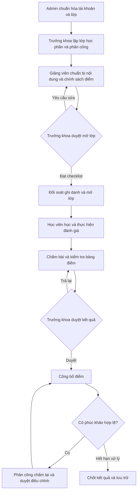

# Workflow vận hành LMS Khoa Luật

**Bản triển khai hiện tại:** xem [Bàn giao vận hành và nghiệm thu](VAN_HANH_VA_NGHIEM_THU.md). Tài liệu này giữ thiết kế mục tiêu và kết quả khảo sát ban đầu; các mục ghi thiếu ở thời điểm khảo sát đã được triển khai theo bản bàn giao.

Ngày lập: 16/10/2026. Phạm vi: đào tạo theo lớp cố định tại Khoa Luật, với bốn vai trò hiện có: Admin, Trưởng khoa, Giảng viên, Học viên.

Đây là thiết kế nghiệp vụ và kế hoạch đưa vào vận hành, đối chiếu với mã nguồn hiện tại. Các trạng thái, màn hình và cơ chế được ghi là **đề xuất** chưa được triển khai chỉ bằng việc bổ sung tài liệu này. Các mốc thời gian, SLA và ngưỡng dưới đây là đề xuất nội bộ để đơn vị đào tạo phê duyệt, không phải quy định bắt buộc của các LMS tham khảo.

## 1. Cơ sở tham khảo

| Hệ thống / tài liệu chính thức | Thực hành được tham khảo | Áp dụng vào LMS này |
| --- | --- | --- |
| [Moodle – Enrolment methods](https://docs.moodle.org/503/en/Enrolment_methods) | Có nhiều phương thức ghi danh, gồm ghi danh theo nhóm | Ghi danh theo danh sách lớp do đơn vị quản lý; không mở tự ghi danh |
| [Moodle – Course completion settings](https://docs.moodle.org/503/en/Course_completion_settings) | Hoàn thành học phần theo tiêu chí được cấu hình | Tách tiến độ học, điều kiện hoàn thành và kết quả đạt/không đạt |
| [Canvas – Grade posting policies](https://community.instructure.com/en/kb/articles/660843-how-do-i-use-posting-policies-in-a-course) | Điểm có thể được giữ lại để công bố thủ công | Tách chấm điểm, duyệt điểm và thời điểm học viên nhìn thấy điểm |
| [Open edX – Course Launch Checklist](https://docs.openedx.org/en/latest/educators/concepts/releasing-course/course_launch_checklist.html) | Chuẩn bị nội dung, đội ngũ, lịch và chính sách điểm trước khai giảng | Dùng checklist và lớp thử trước khi mở lớp chính thức |

Các cơ chế duyệt của Trưởng khoa, đúng hai giảng viên phụ, phúc khảo và phân quyền chi tiết dưới đây là thiết kế cho dự án này; không khẳng định các sản phẩm tham khảo có cùng quy trình.

## 2. Mô hình vận hành và trách nhiệm

Phân biệt ba đối tượng để tránh trộn lịch sử giữa các năm:

- **Học phần:** mã, đề cương, chuẩn đầu ra và nội dung dùng chung.
- **Lớp hành chính:** nhóm học viên cố định, có mã lớp.
- **Lớp học phần:** một học phần được tổ chức cho một lớp hành chính trong một học kỳ/năm học; có lịch, danh sách ghi danh và tổ giảng viên riêng.

Mô hình đích cần `CourseOffering` hoặc mở rộng `TeachingClass` thành lớp học phần. Mỗi ghi danh, đề kiểm tra, lượt làm bài và kết quả phải truy về lớp học phần. Khóa duy nhất đề xuất: `(CourseId, AdministrativeClassId, TermId)`; học lại ở kỳ khác là hồ sơ mới.

| Công việc | Chịu trách nhiệm thực hiện | Người quyết định / duyệt | Bằng chứng bàn giao |
| --- | --- | --- | --- |
| Tài khoản, danh sách lớp, hạ tầng | Admin | Đầu mối quản trị được chỉ định | Biên bản nhập và đối soát dữ liệu |
| Kế hoạch mở lớp, tổ giảng viên | Trưởng khoa | Trưởng khoa | Phân công 1 chính + 2 phụ, lịch học |
| Đề cương, bài học, học liệu, chính sách điểm | Giảng viên chính; hai giảng viên phụ hỗ trợ | Trưởng khoa | Phiên bản nội dung và checklist duyệt |
| Hỗ trợ học tập, phản hồi, theo dõi tiến độ | Tổ giảng viên | Giảng viên chính | Danh sách cần hỗ trợ và xử lý |
| Soạn đề, rubric và lịch kiểm tra | Giảng viên được giao | Giảng viên chính; Trưởng khoa duyệt đợt đánh giá chính thức | Phiên bản đề đã duyệt |
| Chấm bài, đối soát kết quả | Giảng viên được phân công chấm | Giảng viên chính kiểm tra; Trưởng khoa duyệt kết quả | Bảng điểm đã duyệt |
| Công bố, phúc khảo, đóng lớp | Giảng viên chính | Trưởng khoa | Lịch sử công bố, quyết định điều chỉnh, hồ sơ đóng lớp |
| Sự cố kỹ thuật, sao lưu, khôi phục | Admin | Đầu mối vận hành | Ticket và kết quả khôi phục |

Quyền phải được kiểm tra ở API theo cả vai trò và lớp được phân công. Admin vận hành kỹ thuật; việc thay đổi điểm cần quyền nghiệp vụ riêng, lý do và nhật ký. Giảng viên phụ chỉ được chấm bài nằm trong phạm vi được giao. Học viên chỉ thấy bài và kết quả của mình.

## 3. Luồng tổng thể

## 4. Quy trình thực hiện

### WF-01 — Chuẩn bị dữ liệu đầu kỳ

**Chủ trì:** Admin. **Đầu vào:** danh sách học viên, lớp, giảng viên và kế hoạch học kỳ đã được đơn vị bàn giao.

1. Chuẩn hóa mã lớp, email, mã học viên; đối chiếu tài khoản đã có để tránh trùng người.
2. Xem trước dữ liệu nhập, phân biệt tạo mới, cập nhật, chuyển lớp và dòng lỗi; chỉ cập nhật các dòng hợp lệ được xác nhận.
3. Đối soát tổng sĩ số theo từng lớp. Xuất kết quả nhập và danh sách lỗi để sửa, không coi toàn bộ tệp thành công khi còn dòng lỗi.
4. Cấp tài khoản bằng liên kết kích hoạt hoặc mật khẩu tạm riêng; bắt buộc đổi mật khẩu lần đầu. Khóa tài khoản ngừng học theo quyết định và giữ hồ sơ cũ.

**Điều kiện hoàn tất:** số lượng khớp danh sách chuẩn; không trùng định danh; các tài khoản giảng viên có đúng vai trò. Hiện tại import XLSX đã có, nhưng chưa có xem trước/kích hoạt và đang đặt mật khẩu chung `123456`; cần sửa trước khi cấp tài khoản thật.

### WF-02 — Mở lớp học phần và ghi danh

**Chủ trì:** Trưởng khoa. **Đầu vào:** dữ liệu WF-01 và kế hoạch học kỳ.

1. Chọn học phần, lớp hành chính, học kỳ/năm học, ngày bắt đầu và kết thúc.
2. Chọn đúng ba giảng viên khác nhau: một chính và hai phụ; xác nhận phân công.
3. Sinh danh sách ghi danh dự kiến từ lớp; Admin đối soát số lượng, Trưởng khoa xác nhận danh sách.
4. Ghi danh bằng thao tác có thể chạy lại mà không sinh trùng; lưu nguồn, thời điểm và người xác nhận.
5. Khi thêm học viên hoặc chuyển lớp sau thời điểm này, tạo yêu cầu điều chỉnh. Trưởng khoa duyệt, hệ thống cập nhật quyền truy cập và giữ kết quả cũ theo lớp học phần gốc.

**Điều kiện hoàn tất:** không trùng lớp học phần trong cùng kỳ, đủ tổ giảng viên, sĩ số khớp. Không xóa hồ sơ đã phát sinh bài nộp để sửa danh sách.

**Lưu ý hiện tại:** tạo phân công sẽ ghi danh học viên đang có mã lớp tương ứng. Import sau đó, sửa hoặc xóa phân công chưa đồng bộ đầy đủ ghi danh. Vì vậy trình tự tạm thời phải là nhập danh sách trước, phân công sau; thay đổi muộn phải được đối soát thủ công và chưa được xem là luồng vận hành hoàn chỉnh.

### WF-03 — Chuẩn bị, duyệt và công bố nội dung

**Chủ trì:** Giảng viên chính; giảng viên phụ hỗ trợ.

1. Soạn đề cương, mục tiêu, cấu trúc bài học, học liệu, lịch đánh giá và cách tính điểm.
2. Cấu hình điều kiện hoàn thành từng hoạt động; phân biệt bài bắt buộc và tài liệu tham khảo. Mở trang hoặc tải tệp chỉ là bằng chứng truy cập, không tự chứng minh đã hiểu bài.
3. Khai báo thang điểm, trọng số, điểm đạt, số lần làm, quy tắc chọn điểm khi làm lại và quy tắc làm tròn. Trọng số các thành phần phải cộng đúng 100%.
4. Giảng viên phụ kiểm tra liên kết, tệp và rubric; thử bằng tài khoản học viên thử.
5. Gửi duyệt; Trưởng khoa duyệt hoặc trả lại kèm lý do. Sửa nội dung ảnh hưởng đánh giá sau khi duyệt phải tạo phiên bản và duyệt lại.
6. Mở lớp theo lịch sau khi cả nội dung và danh sách ghi danh đạt yêu cầu.

**Checklist mở lớp:** đủ bài tuần đầu, không có tệp lỗi, lịch kiểm tra nằm trong lịch lớp, chính sách điểm rõ ràng, phân quyền đúng, có đầu mối hỗ trợ và hướng dẫn học viên.

### WF-04 — Học tập và hỗ trợ hằng tuần

1. Học viên đăng nhập, xem lớp đang học, lịch và việc cần làm; vào bài được phép truy cập.
2. Hệ thống ghi nhận hoàn thành theo tiêu chí của hoạt động và tính tiến độ từ dữ liệu chi tiết. `ProgressPercent` chỉ là giá trị tổng hợp.
3. Tổ giảng viên xem hoạt động chưa hoàn thành, bài thiếu, học viên cần hỗ trợ; liên hệ qua kênh đã công bố.
4. Đề xuất nhắc hạn trước 24 giờ và cảnh báo không hoạt động 7 ngày. Chỉ bật khi có bộ lập lịch, cơ chế gửi lại và chống gửi trùng; trước đó dùng danh sách theo dõi thủ công.

**Đầu ra:** tiến độ có căn cứ, danh sách cần hỗ trợ và lịch sử xử lý. Mốc 7 ngày có thể thay đổi theo lịch dạy thực tế.

### WF-05 — Tạo và tổ chức bài kiểm tra

1. Giảng viên chọn lớp học phần, hình thức, câu hỏi, điểm tối đa, rubric, thời lượng, cửa sổ mở/đóng và số lượt được phép.
2. Kiểm tra đáp án, tổng điểm, điểm đạt không vượt điểm tối đa, lịch hợp lệ; người duyệt xác nhận trước khi công bố đợt đánh giá chính thức.
3. Khi học viên bấm bắt đầu, máy chủ tạo lượt làm và lưu `StartedAt`, `ExpiresAt`, phiên bản đề. Hạn nộp bằng giá trị sớm hơn giữa hạn đóng và thời điểm bắt đầu cộng thời lượng, trừ gia hạn đã duyệt.
4. Lưu nháp định kỳ; khi mất mạng, cho kết nối lại cùng lượt, dùng bản nháp máy chủ đã xác nhận. Giao diện phải hiển thị lần lưu thành công gần nhất.
5. Nộp bài theo thao tác chống trùng: gửi lại yêu cầu trả cùng kết quả; không tạo thêm lượt. Cấp số biên nhận và thời gian nhận của máy chủ.
6. Hết hạn, tác vụ máy chủ nộp bản nháp cuối cùng theo chính sách đã công bố. Không phụ thuộc đồng hồ hoặc tab trình duyệt còn mở.
7. Giữ đáp án, lời giải và kết quả theo chính sách công bố, tránh lộ khi lớp khác còn thi.

**Ngoại lệ:** gia hạn cá nhân, sự cố cả lớp và cho làm lại phải có người duyệt, lý do, phạm vi áp dụng, thời hạn mới và nhật ký. Không sửa trực tiếp thời gian trong database làm quy trình thường xuyên.

### WF-06 — Chấm, duyệt và công bố điểm

1. Máy chủ chấm phần khách quan; câu tự luận vào hàng đợi chấm và chưa có điểm cuối cùng.
2. Giảng viên được giao chấm từng câu theo rubric, nhập phản hồi; điểm mỗi câu nằm trong `[0, điểm tối đa]`.
3. Giảng viên chính kiểm tra bài thiếu, câu chưa chấm, chênh lệch cần xem lại và công thức tổng hợp.
4. Trưởng khoa duyệt bảng điểm; trả lại nếu sai. Sửa sau duyệt làm mất hiệu lực bản duyệt và yêu cầu duyệt lại.
5. Công bố đúng phiên bản đã duyệt. Trước công bố, API học viên không trả điểm bị giữ lại; sau công bố, chỉ trả kết quả của chính học viên đó.
6. Khi cần quy đổi: `điểm hệ 10 = điểm đạt được / điểm tối đa × 10`; tổng kết bằng tổng các điểm thành phần nhân trọng số. Cấu hình rõ bước làm tròn và quy tắc dùng lượt cao nhất, cuối cùng hoặc lần đầu trước khi mở kiểm tra.

**Đầu ra:** bảng điểm có người chấm, người duyệt, thời điểm công bố và lịch sử phiên bản. Không dùng `AutoScore` như điểm chính thức khi còn câu tự luận hoặc chưa qua duyệt.

### WF-07 — Phúc khảo và kết thúc lớp

1. Học viên gửi yêu cầu trong thời hạn được công bố; đề xuất 7 ngày tính từ công bố điểm.
2. Trưởng khoa phân công người chấm lại; người chấm ban đầu không tự phê duyệt điều chỉnh của chính mình.
3. Lưu điểm cũ, điểm đề xuất, lý do, minh chứng và quyết định. Chỉ bản được duyệt mới thay thế kết quả công bố.
4. Hết thời hạn và xử lý xong mọi yêu cầu: chốt kết quả đạt/không đạt/chưa hoàn thành theo quy tắc đã công bố.
5. Xuất hồ sơ lớp gồm danh sách, phiên bản nội dung/đề, bài nộp, bảng điểm và nhật ký duyệt; kiểm tra khả năng đọc lại.
6. Đóng lớp về chế độ chỉ đọc. Học lại tạo ghi danh mới ở lớp học phần kỳ sau; giữ nguyên lịch sử kỳ trước.

Thời hạn lưu giữ và phạm vi tải xuống do đơn vị xác định trước vận hành. Không tự xóa dữ liệu khi kết thúc lớp.

## 5. Trạng thái và điều kiện chuyển bước — đề xuất

| Đối tượng | Luồng trạng thái | Ràng buộc chính |
| --- | --- | --- |
| Lớp học phần | Draft → PendingApproval → Ready → Active → Grading → Completed → Archived | Ready cần đủ checklist; Active cần đúng lịch và danh sách đã duyệt; Completed cần điểm đã công bố và hết yêu cầu tồn |
| Nội dung | Draft → InReview → Approved → Published → Archived | Trả lại về Draft có lý do; sửa bản đã duyệt tạo phiên bản mới |
| Ghi danh | Pending → Active → Completed; Active → Suspended / Withdrawn | Khôi phục Suspended cần quyết định; Withdrawn giữ hồ sơ và chấm dứt quyền làm bài mới |
| Đề kiểm tra | Draft → InReview → Approved → Published → Closed → Archived | Đề đã có lượt làm không sửa tại chỗ; hủy kỳ kiểm tra phải lưu lý do và xử lý lượt đang làm |
| Lượt làm | InProgress → Submitted → PendingGrading → Graded | Khách quan có thể chuyển thẳng sang Graded; mỗi lượt chỉ có một bài nộp chính thức |
| Bảng điểm | Draft → PendingApproval → Approved → Published → Locked | Trả lại Draft có lý do; mở khóa/điều chỉnh bằng yêu cầu riêng và duyệt lại |

`Graded` là đã chấm; quyền nhìn thấy điểm phụ thuộc trạng thái công bố bảng điểm. Hoàn thành học tập và đạt điểm là hai tiêu chí riêng. Chuyển bước phải kiểm tra ở máy chủ, lưu người thực hiện, thời điểm, lý do và phiên bản; dùng kiểm soát cập nhật đồng thời để tránh ghi đè quyết định.

## 6. Khoảng trống so với mã nguồn

**Cập nhật triển khai đợt 1:** đã bổ sung bản nháp/chờ duyệt/công bố học phần, trả lại có lý do, lịch sử duyệt, khóa sửa nội dung đã gửi duyệt, kiểm tra phiên bản quyết định và quyền đọc bài học ở API. Giảng viên có thể được phân công từ bản nháp. Đã có màn hình thêm bài và xử lý duyệt. Cần áp dụng script `0006_course_review_workflow.sql` trước khi chạy backend mới. Bảng bên dưới giữ nguyên kết quả khảo sát ban đầu; các mục còn lại tiếp tục nằm trong backlog. Đợt 1 dùng thao tác duyệt và công bố gộp; chưa có phiên bản nội dung sau công bố, lịch mở lớp hay checklist tự động đầy đủ của WF-03.

**Cập nhật thời khóa biểu:** đã triển khai lịch học/thi theo lớp học phần, chặn trùng phòng và giảng viên, lưu lịch sử đổi/hủy, gửi thông báo trong LMS và nhắc trước 24 giờ. Học viên/giảng viên xem lịch theo lớp được ghi danh/phân công; có thể tải `.ics` để nhập vào lịch cá nhân. Áp dụng migration `0011_schedule.sql` trước khi chạy API phiên bản mới.

**Cập nhật diễn đàn lớp học:** học viên và giảng viên được phân công trao đổi theo lớp học phần; tác giả/phản hồi viên tự theo dõi chủ đề, người dùng có thể theo dõi hoặc ngừng theo dõi. Phản hồi mới và thao tác ghim/bỏ ghim gửi thông báo trong LMS cho người theo dõi. Chỉ giảng viên phụ trách được ghim đáp án; Trưởng khoa/Admin có quyền đọc nhưng không đăng thay lớp. Áp dụng migration `0012_class_forum.sql` trước khi chạy API phiên bản mới.

**Cập nhật báo cáo học tập cá nhân:** giảng viên được phân công ghi nhận có mặt/vắng/có phép sau khi buổi học kết thúc; mọi cập nhật được lưu nhật ký trong lịch sử sự kiện. Báo cáo học viên tổng hợp tiến độ bài, chuyên cần đã ghi nhận và điểm thành phần từ bảng điểm đã công bố; buổi chưa được điểm danh không tự tính là vắng. Điểm chỉ hiển thị khi bảng điểm đã duyệt/công bố. Áp dụng migration `0013_attendance.sql` trước khi chạy API phiên bản mới.

Đối chiếu tĩnh ngày 16/10/2026; chưa kiểm thử hệ thống triển khai thực tế.

| Hạng mục | Hiện có trong repo | Cần hoàn thiện |
| --- | --- | --- |
| Tài khoản | JWT, bốn vai trò, import XLSX | Kích hoạt, đổi/quên mật khẩu, khóa tài khoản, bỏ mật khẩu chung |
| Học phần | CRUD, bài học, `IsPublished` | Tạo học phần đang đặt công bố ngay; thêm nháp/duyệt/lịch mở |
| Truy cập nội dung | `GET /api/courses/{id}` chưa yêu cầu đăng nhập, trả cả bài học | Tách danh mục công khai và nội dung; kiểm tra ghi danh/phân công ở API |
| Phân công | Đúng 1 chính + 2 phụ, ghi danh khi tạo | Học kỳ, lớp học phần riêng, điều chỉnh danh sách, đồng bộ khi đổi lớp và phân công |
| Ghi danh | Liên kết user–course, có phần trăm tiến độ | Gắn lớp học phần/kỳ, trạng thái và lịch sử; hiện chưa tách học lại theo kỳ |
| Học liệu | Upload, tìm, tải; người đăng nhập có thể xem kho | Phạm vi tài liệu chung/lớp/nội bộ, duyệt và phiên bản |
| Đánh giá | Nháp/công bố, câu khách quan/tự luận, lịch và số lượt | Duyệt đề, phiên bản, bắt đầu lượt, lưu nháp, thời lượng máy chủ, chống nộp trùng và tranh chấp số lượt |
| Thời gian làm bài | Có `DurationMinutes`; lượt được tạo khi nộp | Chưa đo thời lượng từ thời điểm bắt đầu; chưa đủ cho kiểm tra có giới hạn thời gian |
| Điểm | Tự chấm khách quan; tự luận giữ `FinalScore` rỗng | API/màn hình chấm tự luận, rubric, tổng kết, duyệt, công bố và phúc khảo |
| Tiến độ | Có `ProgressPercent` | Bằng chứng hoàn thành từng hoạt động, công thức và báo cáo |
| Vận hành | Health check, CORS, rate limit, script schema | Audit nghiệp vụ, cảnh báo, sao lưu/khôi phục thử, tải thực tế, quy trình phát hành |

Điểm đối chiếu: `backend/Controllers/{Courses,Students,Quizzes}Controller.cs`, `backend/src/LawLms.Application/{Services,Abstractions}.cs`, `backend/src/LawLms.Domain/Entities.cs` và `frontend/src/api.ts`. README cũ ghi giảng viên có thể tạo học phần, trong khi controller hiện chỉ cho DepartmentHead/Admin; workflow này theo quyền ở controller.

## 7. Backlog triển khai theo phụ thuộc

| Mức / thứ tự | Gói công việc | Điều kiện nghiệm thu |
| --- | --- | --- |
| P0 / 1 | Danh tính và bảo vệ nội dung | Không còn mật khẩu chung; học viên ngoài lớp không đọc bài qua URL/API trực tiếp; kiểm tra cả quyền giảng viên phụ |
| P0 / 2 | Học kỳ, lớp học phần và ghi danh | Hai kỳ cùng học phần có lịch sử độc lập; chạy lại ghi danh không trùng; chuyển lớp không làm mất bài cũ |
| P0 / 3 | Duyệt nội dung và mở lớp | Không mở khi thiếu điều kiện; sửa sau duyệt phải duyệt lại; kiểm tra quyền từng chuyển bước |
| P0 / 4 | Lượt làm bài đáng tin cậy | Máy chủ quản lý hạn, khôi phục nháp, nộp một lần; hai yêu cầu đồng thời không vượt số lượt |
| P0 / 5 | Chấm và công bố kết quả | Chấm được tự luận; học viên không thấy điểm giữ lại; điều chỉnh sau công bố có quyết định và phiên bản |
| P0 / 6 | Khả năng vận hành | Khôi phục được DB và tệp; theo dõi lỗi; chạy đạt kịch bản UAT và tải dự kiến |
| P1 | Nhắc hạn, cảnh báo, báo cáo, tối ưu import | Thông báo không trùng, báo cáo khớp hồ sơ chi tiết, import có xem trước |
| P2 | Tích hợp SSO/SIS, chuẩn trao đổi học liệu | Chọn theo nhu cầu tích hợp đã xác nhận; không chặn pilot nếu chưa cần |

Mỗi gói gồm schema/migration, nghiệp vụ, API, giao diện và kiểm thử phù hợp. Trước migration cần thống kê dữ liệu cũ, lập ánh xạ sang lớp học phần và kiểm tra kết quả; không suy diễn học kỳ chỉ từ mã lớp nếu thiếu dữ liệu gốc.

## 8. UAT bắt buộc trước mở lớp thật

| Mã | Kịch bản | Kết quả mong đợi |
| --- | --- | --- |
| U01 | Import có dòng hợp lệ, sai email, trùng người và email giảng viên | Báo đúng từng dòng, không đổi vai trò tài khoản khác |
| U02 | Phân công ba giảng viên trùng người hoặc sai vai trò | Bị từ chối; dữ liệu không ghi dở |
| U03 | Import thêm học viên sau mở lớp, chuyển lớp, ghi danh lại | Danh sách được cập nhật theo phê duyệt; không mất lịch sử hay ghi danh trùng |
| U04 | Học viên ngoài lớp/khách gọi trực tiếp API bài học, đề, bài nộp, điểm | Bị từ chối; không rò nội dung qua API |
| U05 | Giảng viên phụ truy cập lớp được giao và lớp khác | Chỉ thao tác trong phạm vi được giao |
| U06 | Mở lớp hoặc công bố đề thiếu duyệt; sửa bản đã duyệt | Bị chặn hoặc tạo phiên bản phải duyệt lại |
| U07 | Bắt đầu trước giờ, quá giờ, đổi đồng hồ máy, tải lại trang | Tuân thủ giờ máy chủ; giữ cùng lượt và thời hạn |
| U08 | Mất mạng, kết nối lại, nộp hai lần hoặc hai yêu cầu đồng thời | Phục hồi nháp đã lưu, một biên nhận, không vượt số lượt |
| U09 | Đề có tự luận; chấm thiếu hoặc nhập vượt điểm tối đa | Chưa có điểm cuối khi thiếu chấm; điểm sai bị từ chối |
| U10 | Học viên gọi API điểm trước và sau công bố | Trước không nhận điểm giữ lại; sau chỉ nhận điểm của mình |
| U11 | Phúc khảo dẫn tới sửa điểm; hai người cùng sửa | Lưu bản cũ, duyệt lại, phát hiện xung đột cập nhật |
| U12 | Kết thúc lớp rồi học lại kỳ mới | Hồ sơ cũ chỉ đọc; lượt làm và kết quả kỳ mới độc lập |
| U13 | Khôi phục backup ở môi trường riêng | Đăng nhập, đọc bài nộp, bảng điểm và tải tệp khớp mẫu đối soát |

Mỗi ca lưu người chạy, phiên bản phần mềm, dữ liệu thử, kết quả thực tế và minh chứng. Các ca trên là kế hoạch nghiệm thu, chưa phải báo cáo đã chạy đạt.

## 9. Kế hoạch pilot và vận hành hằng ngày

### Trước khai giảng

- T−14 ngày: chốt phạm vi pilot một lớp, một học phần, một tổ giảng viên; đo sĩ số và số người làm bài đồng thời dự kiến.
- T−7 ngày: hoàn tất P0, chạy UAT, huấn luyện đủ bốn vai trò và đối soát danh sách.
- T−3 ngày: chạy bài kiểm tra thử; kiểm thử tải theo số đồng thời dự kiến và biên dự phòng được thống nhất; thực hiện khôi phục mẫu.
- T−1 ngày: Trưởng khoa ký checklist học vụ; Admin xác nhận hạ tầng và phương án quay lui. Chỉ mở khi toàn bộ ca P0 đạt.
- Sau hai tuần pilot: đánh giá lỗi, phản hồi và chất lượng dữ liệu; xử lý vấn đề rồi mới mở rộng.

### Nhịp vận hành

| Nhịp | Người thực hiện | Công việc |
| --- | --- | --- |
| Hằng ngày | Admin | Kiểm tra health, lỗi API, lưu trữ, backup và tác vụ nền |
| Hằng ngày trong đợt đánh giá | Giảng viên chính | Kiểm tra bài nộp, câu chưa chấm, sự cố và yêu cầu gia hạn |
| Hằng tuần | Tổ giảng viên | Theo dõi học viên cần hỗ trợ, kiểm tra học liệu tuần tiếp theo |
| Hằng tuần | Trưởng khoa | Xử lý hàng đợi duyệt, đối soát sĩ số và tiến độ chấm |
| Trước mỗi kỳ thi / đợt mở rộng | Admin và tổ giảng viên | Kiểm tra tải, quyền, thời gian và diễn tập tình huống lỗi |
| Cuối kỳ | Trưởng khoa và Admin | Chốt kết quả, lưu hồ sơ, xác nhận khả năng khôi phục |

### Sự cố và phục hồi

Sự cố mất truy cập hoặc nộp bài diện rộng: Admin ghi nhận, kiểm tra mức ảnh hưởng và cập nhật qua kênh hỗ trợ đã công bố; giảng viên dừng đợt đánh giá nếu cần. Đề xuất tiếp nhận trong 15 phút trong khung giờ thi có trực và cập nhật mỗi 30 phút. Trưởng khoa quyết định gia hạn/thi lại dựa trên phạm vi ảnh hưởng; giữ bài đã nhận và nhật ký làm căn cứ.

Sao lưu phải bao gồm PostgreSQL và kho tệp cùng mốc đối soát. Đề xuất ban đầu RPO không quá 24 giờ cho học liệu, không quá 15 phút cho bài nộp/điểm trong đợt thi; RTO không quá 4 giờ. Chỉ cam kết sau diễn tập và đo đạc; nếu chưa đáp ứng RPO bài nộp thì chưa tổ chức thi chính thức. Backup hằng đêm đơn thuần không đáp ứng mục tiêu 15 phút; cần cơ chế phục hồi theo thời điểm hoặc tương đương.

Phát hành thay đổi theo thứ tự: sao lưu → kiểm thử migration trên bản sao → triển khai staging và nghiệm thu → triển khai trong cửa sổ bảo trì → kiểm tra đăng nhập, đọc bài và nộp thử. Nếu lỗi, dừng ghi dữ liệu khi cần và dùng kế hoạch rollback đã kiểm chứng; không tự phục hồi bản cũ đè dữ liệu bài nộp mới.

### Phiếu quyết định mở vận hành

- [ ] Trưởng khoa xác nhận lịch, chính sách điểm, điều kiện hoàn thành, hạn phúc khảo và tổ giảng viên.
- [ ] Admin xác nhận danh sách học viên, quyền truy cập và cấp tài khoản an toàn.
- [ ] Tất cả gói P0 và ca UAT đã đạt; không còn lỗi làm mất dữ liệu, lộ nội dung hoặc sai điểm.
- [ ] Có kết quả kiểm thử tải, backup/restore, mục tiêu RPO/RTO đã đo và đầu mối trực.
- [ ] Có hướng dẫn cho học viên, kênh hỗ trợ, quy trình gia hạn/thi lại và kế hoạch quay lui.

Người duyệt học vụ: __________. Người xác nhận vận hành kỹ thuật: __________. Phiên bản hệ thống: __________. Ngày mở: __________. Phạm vi pilot: __________.
